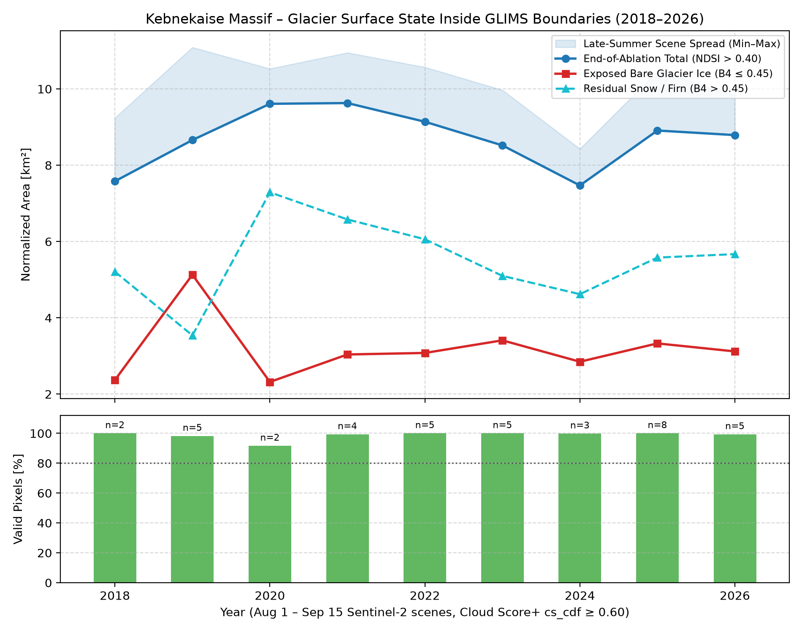
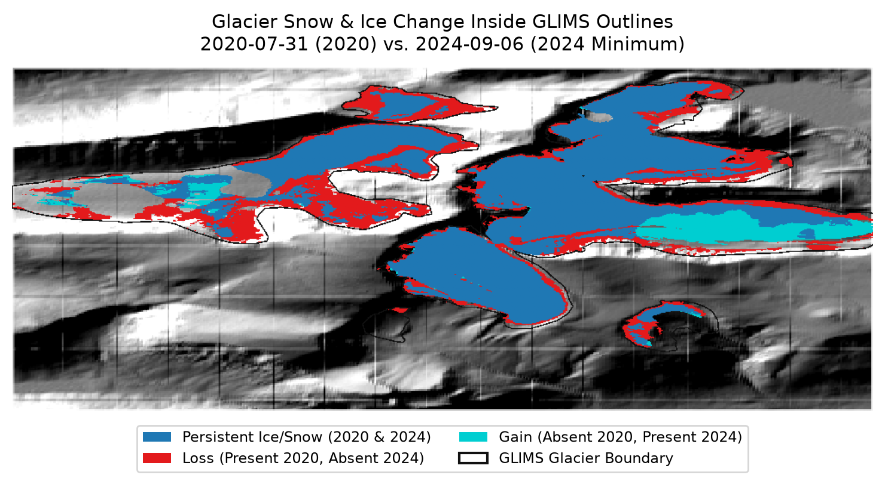

# Kebnekaise Glaciers – Satellite Ice & Snow Analysis (2018–2026)

A Python project tracking late-summer ice and snow cover on the glaciers of the **Kebnekaise massif** in Arctic Sweden (~70 km west of Kiruna, including Storglaciären and Rabots glaciär). Using **Sentinel-2** satellite imagery and **Google Earth Engine**, it measures how much glacier surface remains at the end of each melting season.

## How It Works
- **Focuses only on glaciers:** Clips all measurements to mapped GLIMS glacier borders (~12 km²) so seasonal snow on surrounding mountain ridges does not skew the results.
- **Filters out clouds:** Automatically masks cloudy pixels (`Cloud Score+`) and keeps only clear late-summer satellite passes (August 1 – September 15) with at least 80% visibility.
- **Separates bare ice from fresh snow:** Uses light reflection indices (`NDSI` and red-band brightness) to tell dark **exposed glacier ice** apart from bright **snow**, selecting the clearest end-of-summer date for each year.
- **Maps spatial changes:** Compares 2020 with the 2024 minimum over a 3D terrain relief map (`Copernicus DEM`) to show exactly where ice retreated.

## Key Takeaways
- **2018 & 2024 Record Lows:** Glacier snow and ice cover dropped to **7.58 km²** in 2018 and **7.47 km²** in 2024 — a **22.3% decrease** compared to 2020 (**9.61 km²**), concentrated along the lower glacier tongues.
- **Fast Late-Summer Snowfall Effects:** Early-September snowfall in the Arctic can quickly dust bare ice. In 2024, exposed ice peaked at **6.58 km²** on August 29 before a light snowfall on September 6 covered part of the lower Storglaciären tongue (visible in cyan on the map below).

## Results



### Where the Ice Changed (2020 vs. 2024)


### Yearly Summary

| Year | Selected Date | Clear Scenes | Visibility [%] | Total Ice & Snow [km²] | Bare Ice [km²] | Snow / Firn [km²] |
|-----:|:--------------|-------------:|---------------:|-----------------------:|---------------:|------------------:|
| 2018 | 2018-09-08    |            2 |          100.0 |                   7.58 |           2.37 |              5.21 |
| 2019 | 2019-09-02    |            5 |           98.2 |                   8.66 |           5.13 |              3.54 |
| 2020 | 2020-07-31    |            2 |           91.6 |                   9.61 |           2.32 |              7.29 |
| 2021 | 2021-09-11    |            4 |           99.3 |                   9.63 |           3.04 |              6.58 |
| 2022 | 2022-09-09    |            5 |          100.0 |                   9.14 |           3.08 |              6.06 |
| 2023 | 2023-08-20    |            5 |          100.0 |                   8.52 |           3.41 |              5.10 |
| 2024 | 2024-09-06    |            3 |           99.8 |                   7.47 |           2.85 |              4.62 |
| 2025 | 2025-09-10    |            8 |          100.0 |                   8.91 |           3.33 |              5.58 |
| 2026 | 2026-08-27    |            5 |           99.3 |                   8.79 |           3.12 |              5.67 |

## How to Run
```bash
pip install -r requirements.txt
earthengine authenticate
export GEE_PROJECT_ID="your-project-id"   # PowerShell: $env:GEE_PROJECT_ID="your-project-id"
python fetch_data.py
python plot_results.py